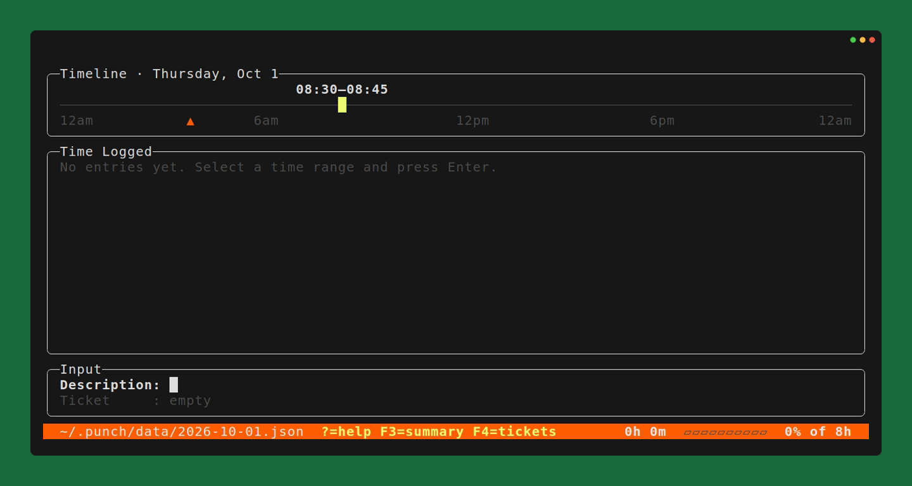

# punch

[](../../actions)
[](https://leglock.github.io/punch/)
[](https://dotnet.microsoft.com/download)
[](../../releases)
[](../../releases)
[](LICENSE)

A TUI time tracker for your workday. Log, label, and export your hours without leaving the terminal.



## Features

- Full-screen terminal UI built with .NET 10 and Spectre.Console
- Day timeline split into 96 quarter-hour slots — select a range and book it
- Label each entry with a description and an optional ticket number
- Pick a ticket from a list (F4) maintained in `~/.punch/tickets.txt`, plus any ticket already used that day
- Edit, move, and resize existing entries in place
- Optional weekday templates for recurring meetings on new timesheets
- Running workday total in the status bar, with non-billable blocks (lunch and breaks by default, configurable) excluded
- Ticket summary view (F3) totalling time per ticket, with billable/unbillable subtotals
- Scrollable time log for busy days
- Color themes (F5) — four built in, plus your own in `settings.json`
- One JSON file per day, stored under `~/.punch/data/`

## Install

Requires the [.NET 10 SDK](https://dotnet.microsoft.com/download).

```bash
git clone https://github.com/leglock/punch.git
cd punch
dotnet run --project src/Punch.CLI
```

Prebuilt self-contained binaries for Windows and Linux are attached to each [GitHub release](../../releases).

## Usage

```bash
punch                          # Open today
punch --date 2026-05-04        # Open a specific date (yyyy-MM-dd)
punch --yesterday              # Open yesterday's timesheet
punch --version                # Show version information
```

Move the cursor to a start time, resize the selection to cover the span you
worked, type a description (and optionally a ticket), then press Enter to log
the entry. Navigating onto an existing entry selects it for editing or deletion.

## Keybindings

| Key              | Action                                   |
|------------------|------------------------------------------|
| Left/Right       | Move cursor / jump between blocks        |
| Up/Down          | Size the selection for a new entry       |
| PgUp/PgDn        | Scroll time log                          |
| Enter            | Log time entry                           |
| Tab              | Switch input field                       |
| Ctrl+E           | Edit selected entry                      |
| Shift+Left/Right | Move entry earlier/later (while editing) |
| Shift+Up/Down    | Grow/shrink entry (while editing)        |
| Ctrl+D           | Delete selected entry                    |
| F3 / Ctrl+T      | Ticket summary                           |
| F4 / Ctrl+P      | Pick a ticket                            |
| F5 / Ctrl+R      | Cycle color theme                        |
| F6 / Ctrl+N      | Toggle the day's note editor              |
| ?                | Toggle help                              |
| Ctrl+Q, Q        | Quit                                     |

## Data

Entries are saved automatically to `~/.punch/data/yyyy-MM-dd.json` — one file
per day — on every add, edit, and delete.

Each day can also have one note, independent of its time entries. Press **F6**
(or **Ctrl+N**) to open the editor in the bottom input area. **Enter** saves and
closes it; **Esc**, **F6**, or **Ctrl+N** closes it without saving draft changes.
Saving an empty note clears it. The saved note is stored as a single `Note`
string in that day's JSON file, even if no time is logged, and is available
when you reopen the editor.

To populate the ticket picker (F4), maintain a `~/.punch/tickets.txt` file with
one ticket per line as `ticket,title` (tab or comma separated). Blank lines and
lines starting with `#` are ignored.

```
# ~/.punch/tickets.txt
PROJ-123,Fix login redirect
PROJ-456,Quarterly report export
```

The picker also lists any ticket already used somewhere on the open day but
missing from `tickets.txt`, shown above the saved ones under a `from the log`
heading. Those have no title on file, so the description of the entry using
them stands in.

Open it either on a selected entry — where it assigns the ticket straight away —
or while typing a new entry, where it fills in the Ticket field and leaves your
description as you left it.

To change the daily hours goal used for the status-bar percentage, create a
`~/.punch/settings.json` file. `targetHours` takes a number of hours in
15-minute increments (`4`, `4.25`, `6.5`, `7.75`, …) and defaults to 8 when the
file is absent. The optional `targetHoursByDay` object overrides the goal for
specific weekdays (case-insensitive day names); days not listed fall back to
`targetHours`. Set a day to `0` to mark it as a day off — the status bar then
shows the total without a percentage. Values that aren't 15-minute increments
are invalid: a per-day value falls back to `targetHours`, and an invalid
`targetHours` falls back to the default 8.

The optional `nonBillable` list controls which entries are excluded from the
workday total (and shown under Unbillable in the F3 summary). Each rule has a
`word` and an optional `match` mode: `"word"` (the default) matches the word
anywhere in the label as a whole word — `"break"` matches "coffee break" but
not "breakfast" — while `"exact"` requires the entire label to equal the word.
Both modes are case-insensitive. When the key is absent, the defaults below
apply; an empty list `[]` disables the exclusion entirely.

```json
{
  "targetHours": 8,
  "targetHoursByDay": {
    "friday": 6.5,
    "saturday": 0,
    "sunday": 0
  },
  "nonBillable": [
    { "word": "lunch", "match": "word" },
    { "word": "break", "match": "word" }
  ]
}
```

### Weekday templates

Add optional `dayTemplates` to `~/.punch/settings.json` to start new timesheets
with recurring entries:

```json
{
  "targetHours": 8,
  "dayTemplates": {
    "monday": [
      { "label": "Daily standup", "ticket": "TEAM-123", "start": "09:00", "end": "09:15" },
      { "label": "Weekly planning", "start": "10:00", "end": "11:00" }
    ],
    "tuesday": [
      { "label": "Daily standup", "ticket": "TEAM-123", "start": "09:00", "end": "09:15" }
    ],
    "friday": [
      { "label": "Weekly review", "start": "15:00", "end": "15:30" }
    ],
    "saturday": [],
    "sunday": []
  }
}
```

- Use full weekday names (Monday through Sunday); weekday and entry property
  names are case-insensitive. Missing/null templates or missing/null/empty
  weekday lists add nothing. Repeat daily meetings in each applicable list;
  there is no shared/default-day template.
- `label` is the required, nonblank Description, **not** the day note; outer
  whitespace is trimmed. `ticket` is optional (missing/null means empty),
  trimmed and uppercased; it need not exist in `tickets.txt`.
- Both times must use exact 24-hour `HH:mm`, on 15-minute boundaries.
  Start: `00:00`–`23:45`; end: `00:15`–`24:00`, strictly after start.
  `24:00` is end-only. Overnight ranges and rounding are not supported.
- Invalid entries are skipped without discarding valid siblings. Entries are
  processed in configuration order: the first accepted entry wins overlaps
  and duplicates; adjacent entries are allowed. Warnings appear in the time log
  (PgUp/PgDn to scroll) and are not saved as notes or entries.

**Templates initialize only dates whose daily JSON file does not exist.**
Accepted entries are saved immediately, before the editor opens. The weekday
comes from the opened date, including `--date` and `--yesterday`, independently
of daily target hours (even a zero-hour target).

This is not synchronization: generated entries are ordinary logged blocks.
Edit, move, resize, reticket, or delete them normally; those changes survive
reopening. They count toward totals and ticket summaries under the existing
non-billable label rules.

Existing logs—including empty, note-only, or corrupt files—never receive
template merges. **Deleting all blocks does not reset templates.** Configuration
changes affect only new timesheets. Manually deleting a daily file makes that
date eligible for initialization again. If no entries are accepted, no file is
created, so fixing the configuration allows another attempt on next startup.
Settings are never rewritten by this feature.

### Color themes

Press **F5** (or **Ctrl+R**) to cycle through the color themes. Punch remembers
your choice in `~/.punch/state.json` for the next run. Four themes are built in:
`ember` (the original orange, and the default), `meadow` (light green),
`glacier` (light blue), and `blossom` (light red).

To add your own, give it a name under `themes` in `settings.json`. Colors may be
hex (`"#87d787"`), `"rgb(135,215,135)"`, or a
[Spectre color name](https://spectreconsole.net/appendix/colors) (`"orangered1"`).
Every key is optional — anything left out or unparseable comes from `ember`.
A theme named like a built-in replaces it and inherits the rest of that
built-in's colors, so you can tweak just one color.

```json
{
  "themes": {
    "dusk": {
      "blockPrimary": "#af87ff",
      "blockAlternate": "#8787d7",
      "blockNonBillable": "#808080",
      "selection": "#ffff5f",
      "selectionBlock": "#ffffff",
      "nowMarker": "#af87ff",
      "ticket": "#5fd7ff",
      "highlight": "#ffff5f",
      "statusBarBackground": "#5f5f87",
      "statusBarText": "#ffffff",
      "statusBarAccent": "#ffff5f",
      "gaugeFilled": "#ffff5f",
      "logo": ["#5f5fff", "#8787ff", "#af87ff", "#d787ff", "#ffafff"]
    }
  }
}
```

| Key | Colors |
|---|---|
| `blockPrimary` / `blockAlternate` | Booked blocks (alternating so neighbors stand apart) |
| `blockNonBillable` | Non-billable blocks and the Unbillable summary row |
| `selection` | The free selection on the timeline |
| `selectionBlock` | A selected existing entry |
| `nowMarker` | The ▲ current-time marker |
| `ticket` | Ticket IDs |
| `highlight` | The picker cursor and "press again" prompts |
| `statusBarBackground` / `statusBarText` / `statusBarAccent` | The bottom status bar and its key hints |
| `gaugeFilled` | The filled part of the status-bar progress gauge (drawn on the status bar background) |
| `logo` | The letters of "punch" in the help panel (repeats if fewer than five) |

Secondary text (hints, durations, the empty timeline track) is always grey.

## Development

```bash
dotnet build                                              # Build the solution
dotnet test                                               # Run all tests
dotnet test --filter "FullyQualifiedName~PunchStorage"    # Run a subset of tests
```
